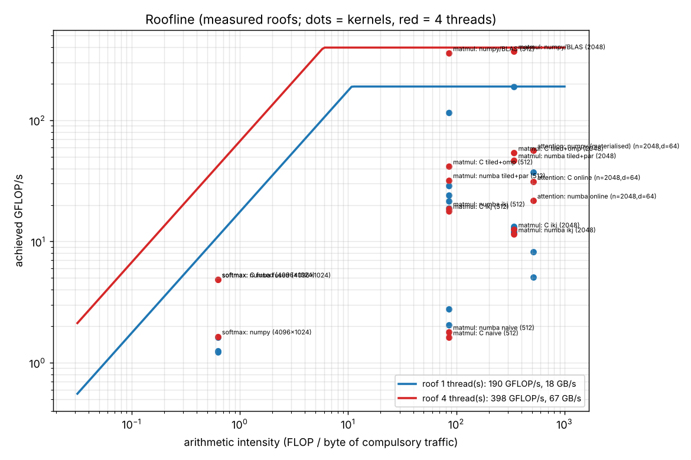

# perf-kernels-cpu

Matrix multiplication, row softmax and attention written three ways each: NumPy (BLAS), Numba, and a C extension. They are optimised step by step (loop order, tiling, threads, fused single-pass math), benchmarked against NumPy/BLAS and placed on a **measured roofline**.

## Setup
```bash
cd ml/perf-kernels-cpu
python3.12 -m venv .venv && . .venv/bin/activate
pip install -r requirements.txt      # and a C compiler with OpenMP (gcc)
```

## Usage
```bash
python -m pytest -q        # 33 tests, ~8 s (builds the C library on first use)
python bench.py            # ~75 s → results/bench.md, results/bench.json, results/roofline.png
```

## Architecture
| file | content |
|---|---|
| `kernels/ref.py` | NumPy references: `A @ B` (BLAS), stable softmax, attention that materialises the n×m scores |
| `kernels/nb.py` | Numba: naive ijk, ikj, tiled + `prange`, fused parallel softmax, online-softmax attention |
| `kernels/kernels.c` | C: the same kernels, OpenMP for the parallel ones |
| `kernels/ckernels.py` | builds `kernels.c` with `cc -O3 -march=native -fopenmp` on first use (atomic, cached by mtime) and wraps it with `ctypes`, so there is no build system and no CPython C-API boilerplate |
| `bench.py` | one subprocess per thread count (1, 4), so BLAS/OpenMP/Numba pools are sized before import. Median of 3-5 runs after warm-up. Also measures the roofs |

Correctness tests run every implementation against NumPy:
- shapes that are not multiples of the 64 tile (1×1, 67×45×91, 130×129×65);
- softmax with logits around 1000, which overflow without max-subtraction;
- attention with peaked scores, which exercises the online-softmax rescaling.

## Results (4 vCPU Xeon @ 2.1 GHz, AVX-512, float32)
**Roofs (measured):** at 1 thread, 190 GFLOP/s (BLAS sgemm) and 18 GB/s (stream add); at 4 threads, 398 GFLOP/s and 67 GB/s.



Matmul (GFLOP/s, n = 512 / 2048):

| impl | 1 thread, 512 | 4 threads, 512 | 1 thread, 2048 | 4 threads, 2048 |
|---|---|---|---|---|
| numpy / BLAS | **116** | **358** | **190** | **371** |
| Numba naive ijk | 2.1 | 1.8 | - | - |
| C naive ijk | 2.8 | 1.6 | - | - |
| Numba ikj | 28.7 | 18.7 | 11.9 | 11.4 |
| C ikj | 24.1 | 17.9 | 12.8 | 12.6 |
| Numba tiled + prange | 21.5 | 32.0 | 12.1 | 46.7 |
| C tiled + OpenMP | 18.8 | 41.6 | 13.3 | 53.8 |

Row softmax 4096×1024 (ms): NumPy 13.0 (1 thread) / 12.8 (4 threads); Numba fused 16.8 / **4.3**; C fused 17.1 / **4.3**.
Attention n = m = 2048, d = 64 (ms): NumPy materialised 28.8 / **19.1**; C online 131 / 34.6; Numba online 211 / 49.4.
Full table: [results/bench.md](results/bench.md).

## Analysis
- **Loop order is the first 10×.** Naive ijk walks B down a column, so every element costs a new cache line. The reduction into one scalar also can't be vectorised without `-ffast-math`, because float addition order matters. ikj makes the inner loop `c[j] += a * b[j]` over contiguous rows, which both compilers vectorise with AVX-512: 2-3 → 24-29 GFLOP/s at n=512.
- **Cache size decides when tiling matters.** At n=512 (1 MB per matrix) ikj already runs from L2/L3. At n=2048 (16 MB per matrix) ikj drops to 12 GFLOP/s, streaming B from memory once per row of A. Tiling (64×64 blocks, 48 KB working set) keeps blocks in cache. Its real payoff here is that it creates independent row bands to parallelise: 4 threads give 54 GFLOP/s, a 4.0× speed-up over 1-thread tiled (13.3), i.e. linear.
- **BLAS is still 7× faster** (371 vs 54 GFLOP/s at 4 threads; 190 vs 13.3 at 1 thread, 14× there). Our best kernel sits at ~13 % of the compute roof. BLAS additionally:
  - packs A and B panels into contiguous buffers;
  - keeps a register-blocked micro-kernel (e.g. 16×6 outputs in registers, FMA every cycle, so each loaded value is reused about 6-16×);
  - tunes block sizes to L1/L2/L3.
  Our inner loop does one load + one FMA + one store per element, which makes it load/store-bound, not FMA-bound. That gap is the lesson: arithmetic intensity at the *register* level, not just the cache level, is what reaches the roof.
- **Softmax.** On the roofline, softmax's compulsory traffic (8 B per element) would allow 0.62 FLOP/B × 67 GB/s ≈ 40 GFLOP/s. All versions are far below that because `exp` costs ~10-20 FLOPs, not the 1 counted, so softmax is compute-bound on `exp` here. Fusing into one parallel kernel wins 3× at 4 threads (4.3 ms vs 12.8 ms). NumPy does not scale with threads at all, because its ufuncs are single-threaded and it makes 4 full passes with temporaries.
- **Online attention vs BLAS.** The online-softmax kernels (FlashAttention's recurrence) never store the 2048×2048 score matrix: O(d) extra memory per query instead of O(n·m). But their dot products are scalar loops, while NumPy spends its time in two BLAS GEMMs. With 4 threads, C online is 1.8× slower than NumPy, and the 16 MB score matrix still fits in this machine's memory hierarchy. The online version wins when n·m no longer fits (long sequences), or when its inner products are blocked into GEMM-like tiles, which is what FlashAttention does on GPUs.
- **More threads can hurt.** 4 threads made naive and ikj *slower* at n=512 (no parallel loop, only BLAS/OMP spin-up and noisy shared vCPUs).

**Debugging note.** The first Numba tiled kernel ran at 2.9 GFLOP/s, 4× slower than its own untiled ikj. Two hypotheses were tested and rejected: 2-D indexing, and `parallel=True` outlining (serial was equally slow). The cause: the inner loop started at a runtime offset `j0`, so Numba could not prove `j ≥ 0` and kept its negative-index wraparound check, which blocks vectorisation. Slicing tile-local views and looping from 0 gave 17 GFLOP/s, a 6× speed-up.

Variance: ±10-20 % between runs on this shared VM (e.g. 1-thread BLAS measured 127-190 GFLOP/s), so the roof uses the best BLAS run per thread count.

## Not done (time box)
Register-blocked micro-kernel / panel packing, explicit SIMD intrinsics, auto-tuned tile sizes, blocked (GEMM-tiled) online attention, perf-counter (cache miss) measurements.
